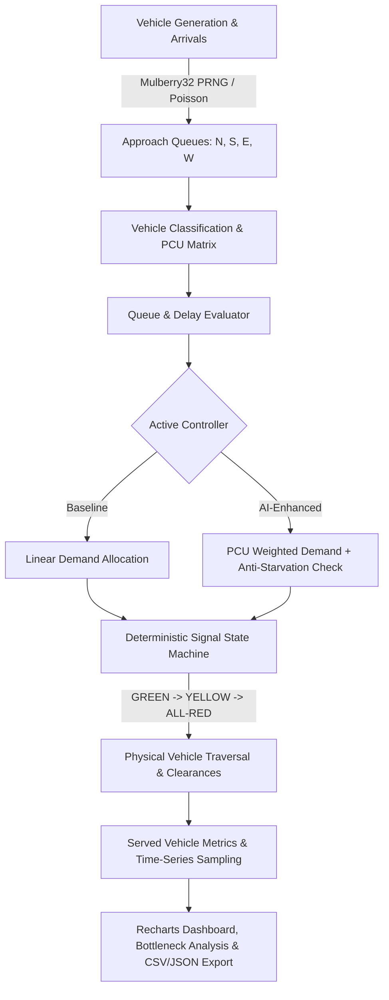

# AI-Enhanced CoSiCoSt — Intelligent Adaptive Traffic Signal Control Dashboard

> **Reverse Engineering Study & AI-Driven Adaptive Enhancement for Indian Mixed Traffic**  
> *Inspired by the Composite Signal Control Strategy (CoSiCoSt) developed by C-DAC (Centre for Development of Advanced Computing)*

---

## 1. Project Overview

In heterogeneous urban traffic environments like India, traffic signals traditionally rely on fixed-time plans or basic vehicle-actuated loops that fail to capture the diversity of vehicle classes, asymmetric arterial congestion, and public transport priority.

This project studies the principles of adaptive traffic signal control inspired by **CoSiCoSt (C-DAC)** and proposes three research enhancements:
1. **Passenger Car Unit (PCU) Weighted Traffic Demand:** Differentiating two-wheelers, auto-rickshaws, passenger cars, public transit buses, and freight trucks.
2. **Anti-Starvation Maximum-Waiting-Time Protection:** Eliminating excessive cross-street delays by overriding signal priorities when a configurable waiting ceiling (e.g. 60s) is reached.
3. **Machine Learning Predictor Interface:** Decoupling the green-time estimation module to support future XGBoost / deep learning inference engines alongside transparent rule-based heuristics.

---

## 2. Technology Stack

- **Framework:** Next.js 16 (App Router)
- **Language:** TypeScript 5
- **UI Library:** React 19 & Tailwind CSS v4
- **Visualization:** HTML5 Canvas (60 FPS top-down junction animation) & Recharts (Analytical time-series)
- **Icons:** Lucide React
- **Simulation Engine:** Custom Deterministic TypeScript Engine (Mulberry32 PRNG)
- **Unit Testing:** Vitest

---

## 3. System Architecture



---

## 4. Signal Controllers & Mathematical Formulations

### A. Baseline Controller (CoSiCoSt-Inspired Demand Approximation)
Allocates green time proportional to raw queue volume:
$$\text{Green Duration} = \text{clamp}\left(G_{\text{min}} + \text{round}(0.85 \times Q_{\text{phase}}), G_{\text{min}}, G_{\text{max}}\right)$$
- $Q_{\text{phase}} = Q_{\text{primary}} + Q_{\text{secondary}}$ (e.g., North + South)
- $G_{\text{min}} = 10\,\text{s}$, $G_{\text{max}} = 45\,\text{s}$

### B. AI-Enhanced Controller
1. **Weighted Traffic Score:**
   $$W_{\text{approach}} = \sum_{v \in \text{queue}} w(v)$$
   Where Indian mixed fleet weights are:
   - Motorcycle / Two-Wheeler: **1.0**
   - Auto-Rickshaw: **2.0**
   - Passenger Car: **2.0**
   - Public Transit Bus: **5.0** (Passenger priority)
   - Heavy Truck: **6.0** (Slow acceleration & clearance requirement)

2. **Waiting Time Acceleration Factor:**
   $$S_{\text{phase}} = W_{\text{phase}} \times \left(1 + 0.03 \times \bar{t}_{\text{wait}}\right)$$

3. **Anti-Starvation Trigger:**
   If $\max_{v \in \text{opposing}} t_{\text{wait}}(v) \ge T_{\text{max\_wait}}$ (default 60s):
   - Overrides normal queue priority once the active phase satisfies $G_{\text{min}}$.
   - Immediately transfers green priority to the starving corridor.

4. **Jain's Fairness Index:**
   Measures equity of waiting times across all 4 corridors:
   $$J = \frac{\left(\sum_{i=1}^n x_i\right)^2}{n \sum_{i=1}^n x_i^2}$$
   Where $x_i = \frac{1}{\bar{t}_{\text{wait}, i} + 1}$.

---

## 5. Getting Started & Development Commands

### Prerequisites
- Node.js 18+ (tested on Node v20 LTS and v24)
- npm 10+

### Installation
```bash
git clone <repository-url>
cd cosicoset
npm install
```

### Run Locally (Dev Server)
```bash
npm run dev
```
Open [http://localhost:3000](http://localhost:3000) in your browser.

### Run Unit Tests
```bash
npm test
```

### Production Build
```bash
npm run build
npm start
```

---

## 6. How to Deploy to Vercel

1. Push your repository to GitHub or GitLab.
2. Log into [vercel.com](https://vercel.com) and click **"Add New Project"**.
3. Import the `cosicoset` repository.
4. Framework preset will automatically detect **Next.js**.
5. Click **"Deploy"**. The build will compile statically and deploy in under 60 seconds.

---

## 7. College Professor Demonstration Sequence

1. **Step 1:** Open the **"Professor Guided Demo"** tab in the dashboard.
2. **Step 2:** Click **"Configure Balanced Traffic"** to establish baseline junction rhythm (15 vehicles per approach).
3. **Step 3:** Click **"Inject Heavy Arterial Queue"** to simulate an Indian mixed commuter rush (South: 35, North: 20, East: 10, West: 5).
4. **Step 4:** Run the **Baseline Controller** and observe starvation on East/West cross-streets.
5. **Step 5:** Click **"Reset Simulation with Exact Seed"** to preserve identical initial conditions.
6. **Step 6:** Launch the **AI-Enhanced Controller** and observe the automated anti-starvation priority override.
7. **Step 7:** Open the **"Controller Comparison Benchmark"** tab to review percentage delay reductions, throughput gains, and Jain's Fairness Index.

---

## 8. Academic Disclaimer & Limitations

- **Educational Prototype:** This project is an academic simulation built for reverse-engineering research and demonstration purposes. It does not use proprietary source code or confidential algorithms from C-DAC.
- **Micro-Simulation Scope:** The current implementation models through movements on a four-way intersection. Left-turn slip lanes and protected right-turn arrow phases can be incorporated as future research extensions.
